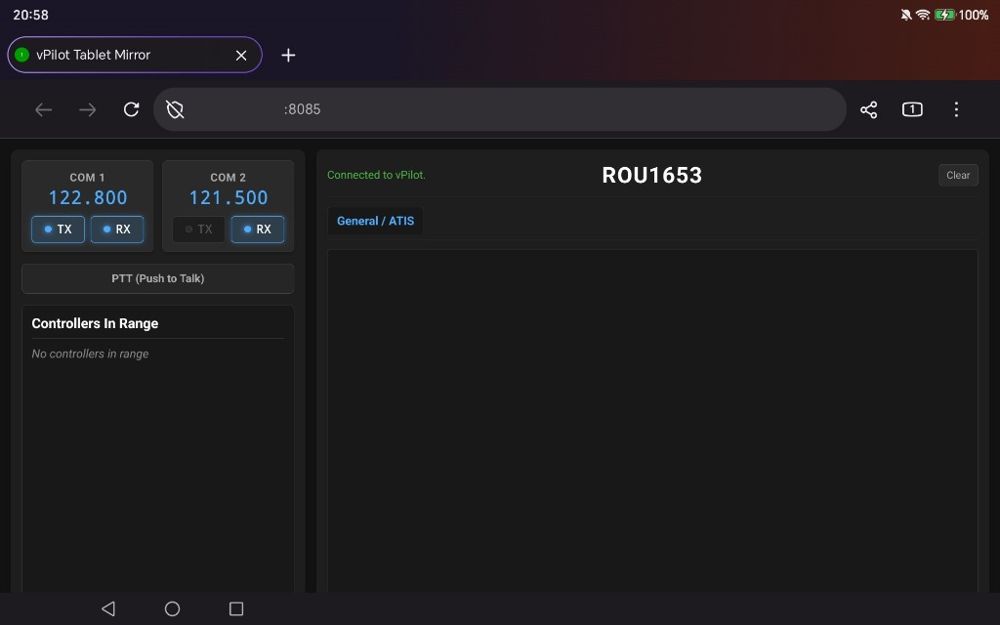

# vPilot Tablet Dashboard

A lightweight, responsive web dashboard and companion mirror for [vPilot](https://vpilot.rosscarlson.dev/) (VATSIM pilot client). View controllers in range and monitor active COM1 and COM2 frequencies in real time.

<p align="center">
  
</p>

---

## ✨ Features

- **Realistic COM1 & COM2 RX/TX Indicators**: Live indicators styled identically to the real vPilot client (`#00a2ff`). The TX light illuminates on your active transmit radio when you press your Push-To-Talk (PTT) key, and the RX light indicates incoming audio.
- **Automatic Callsign Sync**: Automatically synchronizes your active callsign straight from vPilot once connected to the VATSIM network — no manual SimBrief Pilot ID or callsign entry required.
- **Independent Scrolling Panels**: The controller list and chat/message tabs scroll separately while keeping the top radio header and callsign fixed in view.
- **Silent Background Server Management**: When vPilot starts, the plugin automatically launches the local web server silently in the background and closes it cleanly when vPilot exits.
- **Zero Configuration IP Handling**: The dashboard automatically detects your PC's IP address dynamically using `window.location.hostname`. No configuration files or manual IP edits required.

---

## 📁 Repository Structure

```
vPilot-Tablet-Dashboard/
├── screenshots/
│   └── dashboard-preview.jpg   # Tablet dashboard preview
├── Dashboard/
│   ├── index.html              # Responsive web dashboard
│   └── Launch_Dashboard.bat    # Standalone server launcher (Python http.server)
├── Plugin/
│   ├── vPilotTabletMirror.dll  # Pre-compiled vPilot companion plugin
│   ├── Fleck.dll               # WebSocket server dependency
│   └── Newtonsoft.Json.dll     # JSON serialization dependency
└── Source/
    ├── vPilotTabletMirror.sln  # Visual Studio solution
    └── vPilotTabletMirror/     # C# plugin source code
```

---

## 🚀 Quick Start & Installation

### Step 1: Install the vPilot Plugin

1. Close vPilot if it is currently running.
2. Open Windows File Explorer and navigate to your vPilot plugins folder:
   ```
   %LOCALAPPDATA%\vPilot\Plugins
   ```
   *(Paste the path above into the File Explorer address bar and press **Enter** — it resolves to `C:\Users\<YourUsername>\AppData\Local\vPilot\Plugins`)*.
3. Copy all files from the `Plugin/` directory into this folder:
   - `vPilotTabletMirror.dll`
   - `Fleck.dll`
   - `Newtonsoft.Json.dll`
4. *(Optional)* If you keep this repository outside your `Documents` folder, you can create a text file named `dashboard_path.txt` inside `%LOCALAPPDATA%\vPilot\Plugins\` containing the full path to your `Dashboard` directory (e.g. `C:\vPilot-Tablet-Dashboard\Dashboard`). By default, the plugin automatically looks in standard locations like `Documents\vPilot-Tablet-Dashboard\Dashboard`.

---

### Step 2: Find Your PC's Local IP Address

To view the dashboard from your tablet or another device on your local Wi-Fi:

1. On your flight sim PC, open **Command Prompt** or **PowerShell** (Press `Win + R`, type `cmd`, and press **Enter**).
2. Type `ipconfig` and press **Enter**.
3. Look for your active network connection (Wi-Fi or Ethernet) and find the **IPv4 Address**:
   ```
   IPv4 Address. . . . . . . . . . . : 192.168.1.50
   ```
   *(Your address will typically begin with `192.168.x.x` or `10.0.x.x`)*.

> **Tip: Using a Fixed / Static IP Works Better**  
> Assigning a fixed (static) local IP address to your flight simulator PC (or configuring a DHCP reservation in your home router) is strongly recommended. That way, your PC's IP address will never change, and you can save a bookmark or shortcut on your tablet without ever having to look up the IP address again.

---

### Step 3: Connect Your Tablet

1. Start **vPilot**. The plugin will automatically initialize the WebSocket server (port `9090`) and launch the dashboard web server (port `8085`).
2. On your tablet, smartphone, or secondary computer connected to the same Wi-Fi network, open any browser (Safari, Chrome, Edge, Firefox).
3. In the address bar, type:
   ```
   http://<YOUR-PC-IP>:8085
   ```
   *Example: `http://192.168.1.50:8085`*
4. The dashboard will load and automatically connect to your simulator session.

---

## 🔒 Firewall & Network Troubleshooting

If your tablet shows "Cannot connect" or the page fails to load:

- **Same Network**: Verify that your tablet is connected to the same local Wi-Fi or LAN as your flight simulator PC (not a guest Wi-Fi network with client isolation).
- **Windows Defender Firewall**:
  1. Open **Windows Security** → **Firewall & network protection**.
  2. Click **Allow an app through firewall**.
  3. Ensure **Python** and **vPilot** have checkboxes enabled for **Private** networks.
  4. Alternatively, add an Inbound Rule in Windows Firewall allowing TCP ports `8085` and `9090`.

---

## 🛠️ Building from Source

For developers wishing to modify or compile the plugin:

1. Open `Source/vPilotTabletMirror.sln` in **Visual Studio 2022** (or build with MSBuild).
2. Ensure target framework is set to **.NET Framework 4.7.2**.
3. Select **Release** configuration and build the solution.
4. Compiled output will be generated in `Source/vPilotTabletMirror/bin/Release/`.

---

## 📄 License & Disclaimer

This project is an open-source, community-created companion tool and is not officially affiliated with or endorsed by VATSIM or the author of vPilot.
