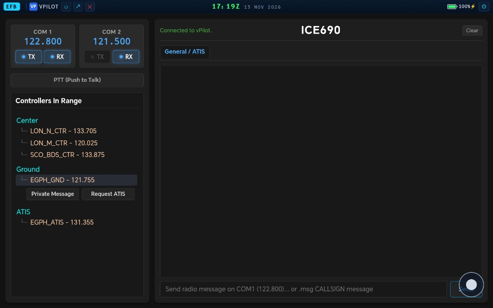
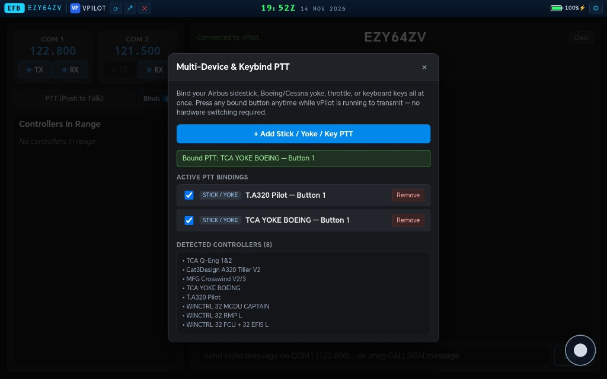
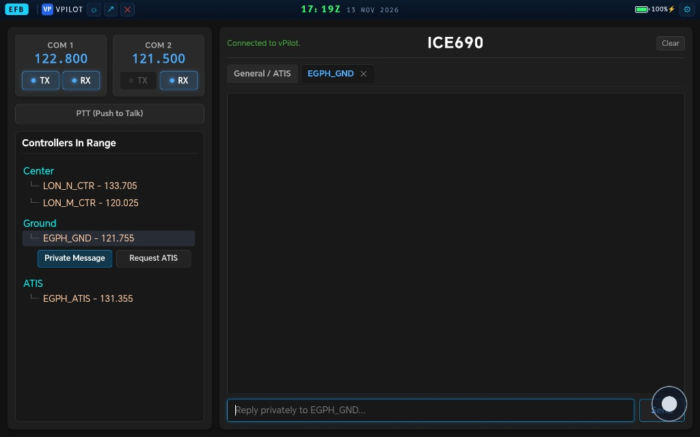
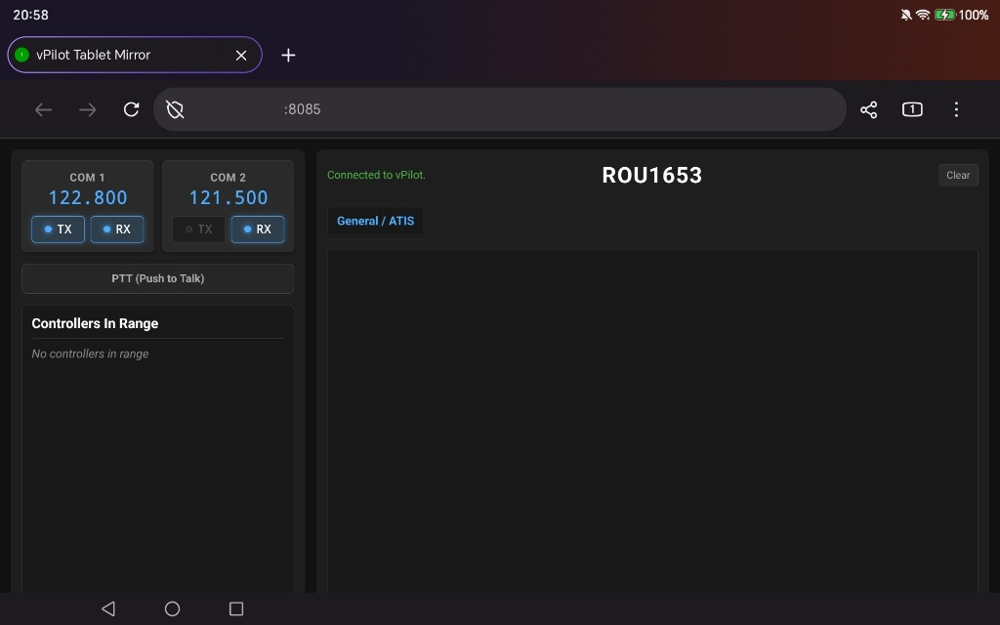

# vPilot Tablet Dashboard

A lightweight, real-time web companion and **Multi-Device PTT** plugin for [vPilot](https://vpilot.rosscarlson.dev/) (VATSIM pilot client). Control COM1/COM2 frequencies, send and receive radio & private messages, inspect controller ATIS, and bind **multiple flight sticks, yokes, and keyboard keys** as Push-To-Talk at the same time — all synced live across your PC browser, iPad/Android tablet, phone, or [Virtual EFB](https://flightsim.to/addon/118791/virtual-efb-electronic-flight-bag-for-android-pc-checklists-wind-calc-simbrief-navigraph).

<p align="center">
  
</p>

---

## ✨ What's Included

- **Multi-Device & Keybind PTT**: Bind multiple controllers simultaneously (such as an Airbus sidestick **and** a Boeing/Cessna yoke, throttle switches, or keyboard/mouse keys) with one press inside the **Binds** panel. No more changing vPilot's single PTT setting when swapping aircraft or hardware.
  - Works **silently inside vPilot** whenever vPilot is open — **even when the dashboard browser is closed**.
  - Saved persistently to `%LOCALAPPDATA%\vPilot\Plugins\ptt_bindings.json` and skips held toggle switches cleanly when binding.
- **Two-Way Radio, Dot-Commands & Private Messaging**: Type and send radio text messages on your active COM TX frequency from **General / ATIS**, run native vPilot dot-commands (`.ctaf KJFK`, `.wx ICAO` / `.metar ICAO`, `.atis CALLSIGN`, `.com1`/`.com2`, `.x`/`.sq`, `.wallop`, `.clear`), reply inside private message tabs, or start a PM anytime using `.msg`, `.chat`, or `.message CALLSIGN [text]`. Command replies (CTAF frequencies, METARs, ATIS, and system notices) mirror back live to all open screens, and incoming PMs on inactive tabs show a glowing unread indicator.
- **Controller 2-Button Action Bar**: Click any controller under **Controllers In Range** to open **Private Message** or **Request ATIS** right underneath that controller.
- **Live Multi-Screen Sync**: Your PC browser, Virtual EFB, and physical tablet all stay synchronized in real time over WebSockets — COM1/COM2 TX & RX lights, PTT state, chat history, PM tabs, and PTT binds mirror automatically across every open client.
- **Zero External Dependencies**: Built-in web server (port `8085`) and WebSocket server (port `9090`) start automatically when vPilot opens and close cleanly when vPilot exits — no Python or manual launcher needed.
- **Works Directly or Over LAN**: Automatically uses `window.location.hostname` on Virtual EFB (Android) and tablets (`http://<YOUR-PC-IP>:8085`), `http://localhost:8085` on the simulator PC, and falls back to `localhost` even if `Dashboard/index.html` is opened directly (`file://`).

---

## 📸 Screenshots

<p align="center">
  
  <br>
  <em>Bind your sidestick, yoke, throttle, or keyboard triggers all at once inside the Binds modal</em>
</p>

<p align="center">
  
  <br>
  <em>One-tap Private Message tabs, Request ATIS, and live two-way reply bar</em>
</p>

<p align="center">
  
  <br>
  <em>Clean dark cockpit layout tailored for tablets, phones, and Virtual EFB</em>
</p>

---

## 🚀 Installation

### Option A: 1-Click Install (Recommended)

1. Extract the **entire** downloaded ZIP archive to any folder (e.g., `Documents\vPilot-Tablet-Dashboard-v1.2`).
   - **Tip:** Before extracting, right-click the downloaded `.zip` file → **Properties** → under **Security**, check **Unblock** → **Apply** → **OK**. This prevents Windows Smart App Control from blocking `Install.bat`.
2. Double-click **`Install.bat`** inside the extracted folder.
   - **If Windows Smart App Control says** *"Smart App Control blocked a file that may be unsafe"* / *"This file was blocked because files of this type from the internet can be dangerous"*:
     1. Right-click `Install.bat` and select **Properties**.
     2. At the bottom of the **General** tab, under **Security**, check **Unblock**.
     3. Click **Apply** → **OK**, then run `Install.bat` again.
   - *(If Windows Defender SmartScreen appears, click **More info** → **Run anyway**).*
   - `Install.bat` automatically closes vPilot if running, removes Windows *"Mark of the Web"* security locks, copies all 3 required DLLs (`vPilotTabletMirror.dll`, `Fleck.dll`, `Newtonsoft.Json.dll`) into `%LOCALAPPDATA%\vPilot\Plugins`, configures `dashboard_path.txt`, and prints your tablet URL.
   - **No manual `.dll` copying is needed** when using `Install.bat` — continue straight to **Connect Your Devices** below.

### Option B: Manual Installation *(Skip if you ran `Install.bat`)*

> [!IMPORTANT]
> **Windows Security Block Notice:** Only follow Option B if you prefer not to run `Install.bat`. Windows blocks `.dll` and `.bat` files downloaded from the internet. Before copying or running manually, right-click the `.zip` (or each `.dll` and `.bat` file) → **Properties** → check **Unblock** → **Apply** → **OK**.

1. Close **vPilot** if running.
2. Press `Win + R`, paste `%LOCALAPPDATA%\vPilot\Plugins`, and press **Enter**.
3. Copy all 3 unblocked DLLs from `Plugin/` into that folder:
   - `vPilotTabletMirror.dll`
   - `Fleck.dll`
   - `Newtonsoft.Json.dll`
4. *(Optional)* Place the `Dashboard/` folder anywhere (e.g. `Documents`).
   - **No Python needed with vPilot:** When vPilot starts, the plugin's built-in HTTP (`8085`) and WebSocket (`9090`) servers start automatically for both PC and external Android/tablet devices.
   - **Using on PC only:** You can double-click `Dashboard/index.html` directly in your browser, or open `http://localhost:8085` while vPilot is running.
   - **Optional standalone launcher (without vPilot running):** Run `Dashboard/Launch_Dashboard.bat` (requires Python; unblock via **Properties → Unblock** if Smart App Control blocks it).
   - *(Optional)* Create `dashboard_path.txt` inside `%LOCALAPPDATA%\vPilot\Plugins\` containing the path to your `Dashboard` folder. *(Even without it, `vPilotTabletMirror.dll` already contains the full dashboard UI embedded inside.)*

---

## 🌐 Connect Your Devices (Live Sync)

1. Start **vPilot** and wait 10–15 seconds for its initial startup scan to finish. The built-in HTTP (`8085`) and WebSocket (`9090`) servers start automatically.
2. Open the dashboard wherever you want it:
   - **On your PC Browser:**
     ```
     http://localhost:8085
     ```
     *(Or double-click `Dashboard/index.html` directly — it automatically connects to `ws://localhost:9090`.)*
   - **On [Virtual EFB](https://flightsim.to/addon/118791/virtual-efb-electronic-flight-bag-for-android-pc-checklists-wind-calc-simbrief-navigraph) (Android App) or an iPad, Android Tablet, or Phone (Same Wi-Fi):**
     1. Open Command Prompt on your PC, run `ipconfig`, and note your **IPv4 Address** (for example `192.168.1.50` — or copy the address shown by `Install.bat`).
     2. Open your tablet browser and go to:
        ```
        http://<YOUR-PC-IP>:8085
        ```
     > **Tip:** Assigning a static local IP / DHCP reservation for your flight sim PC keeps your tablet bookmark working permanently without checking `ipconfig` again.

All open sessions (PC browser, Virtual EFB, and tablet) mirror vPilot and stay synced with each other automatically.

---

## 🎮 How to Use

### Multi-Device PTT Setup (Stick + Yoke + Keys)
1. Click **`Binds`** next to the **PTT (Push to Talk)** button.
2. Click **`+ Add Stick / Yoke / Key PTT`**, then press the PTT trigger on your **stick** (e.g., Airbus sidestick).
3. Repeat once for your **yoke** (or any throttle button / keyboard key / mouse button).
4. Once your PTTs are set up, they are saved locally (`ptt_bindings.json`) and stay active at the same time in the background whenever **vPilot** is running — there is **no need to open the dashboard browser again**, and you don't even need a PTT key bound in vPilot's own settings.

### Radio, Dot-Commands, Private Messages & ATIS
- **Send Radio Text:** Select the **General / ATIS** tab, type your message, and press **Enter** or **Send** to transmit on your active COM TX frequency.
- **vPilot Dot-Commands:** Run native vPilot commands directly from any PC or tablet browser — replies (CTAF frequencies, METARs, ATIS lines, and errors) appear automatically in **General / ATIS** across all synced devices:
  - `.ctaf KJFK` — Look up an airport's CTAF frequency
  - `.wx KJFK` / `.metar KJFK` — Fetch live METAR weather
  - `.atis EGPH_ATIS` — Request a controller's VATSIM ATIS
  - `.com1 124.850` / `.com2 121.500` — Tune COM1 or COM2 frequency
  - `.x 2200` / `.sq 7000` — Set transponder squawk code
  - `.msg CALLSIGN [text]` / `.chat CALLSIGN` / `.message CALLSIGN` — Open a PM tab (and send text if included)
  - `.clear` — Clear the dashboard message log
- **Controller 2-Button Bar:** Click any controller in **Controllers In Range** to expand the 2-button bar (**Private Message** | **Request ATIS**).
- **Unread PM Badge:** Inactive PM tabs show a glowing dot whenever a new message arrives until you open that tab.

---

## 📁 Repository Structure

```
vPilot-Tablet-Dashboard/
├── Install.bat                              # 1-Click Installer (unblocks DLLs & installs to vPilot)
├── screenshots/
│   ├── controller-actions-radio-chat.jpg    # Main v1.2 preview (Controller Bar & Radio Chat)
│   ├── multi-ptt-binds.jpg                  # Multi-Device & Keybind PTT setup modal
│   ├── private-message-tab.jpg              # Controller private message tab view
│   └── dashboard-preview.jpg                # Compact dark tablet dashboard view
├── Dashboard/
│   ├── index.html                           # Responsive dashboard UI (also embedded in DLL)
│   └── Launch_Dashboard.bat                 # Optional standalone HTTP server fallback
├── Plugin/
│   ├── vPilotTabletMirror.dll               # Pre-compiled vPilot plugin (embedded HTML + Multi-PTT)
│   ├── Fleck.dll                            # WebSocket server dependency
│   └── Newtonsoft.Json.dll                  # JSON serialization dependency
└── Source/
    ├── vPilotTabletMirror.sln               # Visual Studio solution (.NET Framework 4.7.2)
    └── vPilotTabletMirror/
        ├── TabletPlugin.cs                  # vPilot plugin, HTTP & WebSocket server, message routing
        ├── MultiPttManager.cs               # DirectInput + Win32 global Multi-PTT polling & capture
        └── Properties/AssemblyInfo.cs
```

---

## 🔒 Troubleshooting

- **Stuck on *"Connecting to vPilot mirror..."*:**
  - Confirm **vPilot** is running and wait 10–15 seconds for its initial simulator scan.
  - Use **`http://localhost:8085`** on PC (or `http://<YOUR-PC-IP>:8085` on Virtual EFB / tablet). If opening `Dashboard/index.html` directly from disk, make sure you're on **v1.2+**.
  - If you installed manually without `Install.bat`, unblock all 3 `.dll` files in `%LOCALAPPDATA%\vPilot\Plugins\` (**Properties → Unblock → OK**) and restart vPilot.
- **Tablet cannot connect over Wi-Fi:**
  - Ensure both PC and tablet are on the same Wi-Fi/LAN (not a guest network with client isolation).
  - Allow **vPilot** on **Private** networks in **Windows Security → Firewall & network protection → Allow an app through firewall**, or allow TCP ports `8085` and `9090`.

---

## 🗑️ Uninstalling

This plugin does not modify the Windows Registry or install any background services. To uninstall it:

1. **Close vPilot** so the plugin files are not in use.
2. Press `Win + R`, paste `%LOCALAPPDATA%\vPilot\Plugins`, and press **Enter**.
3. Delete only the files installed/created by this plugin:
   - `vPilotTabletMirror.dll`
   - `Fleck.dll`
   - `Newtonsoft.Json.dll`
   - `dashboard_path.txt`
   - `ptt_bindings.json` *(optional — stores your saved Multi-PTT bindings; delete it for a full clean removal, or leave it if you plan to reinstall later)*
   > **Note:** Do **not** delete the entire `Plugins` folder if you have other vPilot plugins installed there.
4. *(Optional)* Delete your extracted `vPilot-Tablet-Dashboard` folder.

---

## 🛠️ Building from Source

1. Open `Source/vPilotTabletMirror.sln` in Visual Studio (or build with MSBuild) targeting **.NET Framework 4.7.2**.
2. Ensure vPilot is installed (references `RossCarlson.Vatsim.Vpilot.Plugins.dll`, `SharpDX.dll`, `SharpDX.DirectInput.dll`, `bbv.Common.EventBroker.dll`, and `Microsoft.FlightSimulator.SimConnect.dll` under `%LOCALAPPDATA%\vPilot\`).
3. Build **Release** configuration (`Source/vPilotTabletMirror/bin/Release/vPilotTabletMirror.dll`).

---

## 📄 License & Disclaimer

This project is an open-source, community-created companion tool and is not officially affiliated with or endorsed by VATSIM or the author of vPilot.
